# Gone Fishin

A discord bot that allows users to collect digital cards. 

## What is it?

"Gone Fishin" is a fun card collecting game. It is currently implemented as a [discord bot](https://docs.discord.com/developers/bots/overview), but I plan to develop a web version later with a dedicated website. 

The art for the cards was hand-drawn (no AI!) by me and my friends, and follows a fish theme. Here are a couple of examples I drew using a free open-source drawing program called [Krita](https://krita.org/en/):

Once the bot has been added to a discord server, users may interact with it using several different commands:

`/voucher-receive` - *Receive your daily pack voucher! Users can receive one pack voucher every 24 hours using this command, which can be used to buy a card pack from any availible set.*

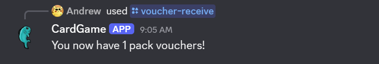

 

`/buy-pack` - *Use a pack voucher to buy a pack of cards for any availible set! Select the set using the set parameter. Set options are dynamically populated according to which sets are currently availible.*

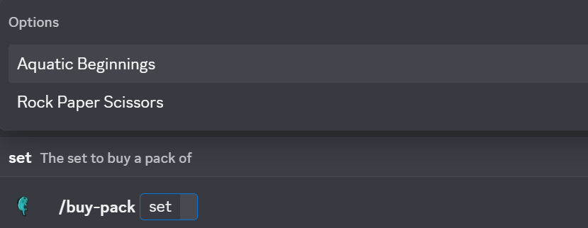

 

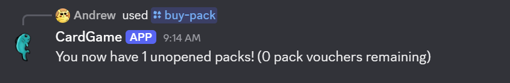

 

`/open-pack` - *Open one of your card packs! You can select from any of the sets that you have card packs for. Each card has a name, a piece of art, the name of its illustrator, and a rarity. The rarity is shown in the bottom right corner -- the more diamond symbols, the more rare the card is! Common cards are blue, uncommon cards are green, and rare cards are orange.*

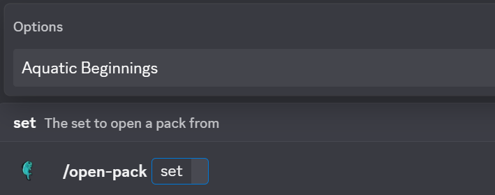

 

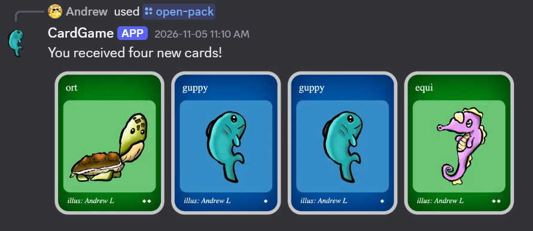

 

`/view-collection` - *View which cards you currently own for a specific set! You can select from any of the sets in the game. Your completion percentage will be shown, as well as images of any cards you have collected from that set (with the number of copies displayed in the top right corner of that card). Any missing cards will be missing their name, art, and illustrator, so users may only see what a card looks like once it has been collected.*

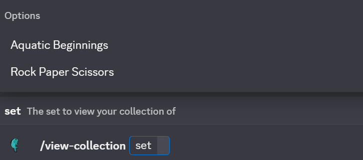

 

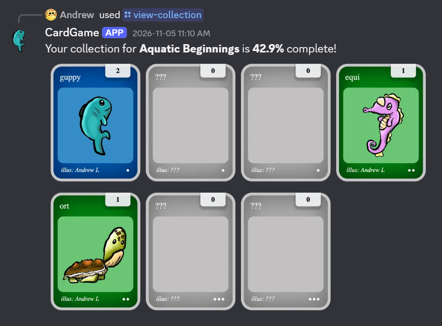

 

`/go-fishin` - *A special command that gives you something random! You can go fishin as many times as they want until your fishing line breaks, in which case you need to wait 2 hours for it to be repaired. Usually you will get some common cards, a pack, or a pack voucher, but occasionally you may get something more rare!*

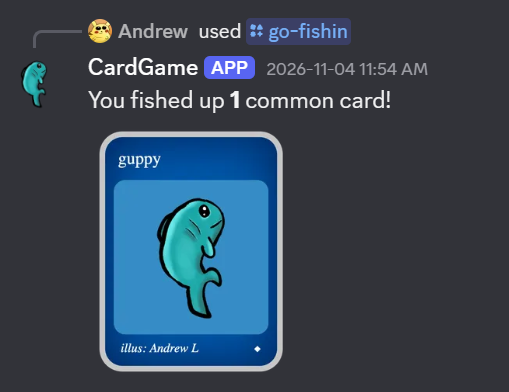

 

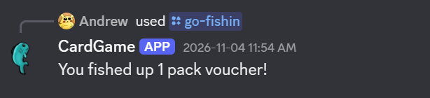

 

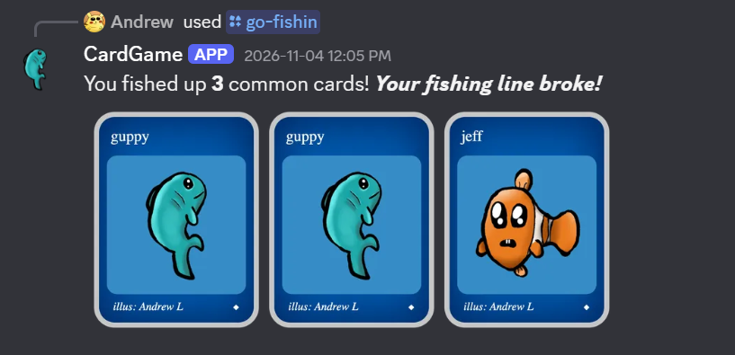

 

## How/why was it made?

Primarily, I created this card game to motivate myself to create more digital art. Since early 2025, I have been enjoying digital art and drawing, and I thought that making a card collection game would be great motivation to draw more and to share my art with my friends in a creative way. 

I also started this project because I wanted to learn more about deploying applications with persisting user data. This involved designing and working directly with an SQLite relational database. While I have learned about relational database design in the past through school assignments and projects, I wanted a personal project where I could apply the things I've learned to a real application. Additionally, I figured a card game would be good because it involves adding new cards and sets over time, which involves database maintenance through database migrations. 

## How does it work?

"Gone Fishin" is a [node.js](https://nodejs.org/en) [TypeScript](https://www.typescriptlang.org/) application that makes use of [drizzle ORM](https://orm.drizzle.team/) for database management and [discord.js](https://discord.js.org/) to interact with the discord API. The cards are dynamically generated using [React](https://react.dev/) and [Puppeteer](https://pptr.dev/) to generate card HTML and CSS on a headless chrome instance. The resulting webpages are screenshotted, and the resulting buffers are used to create the card and card collection UI elements. I used a simple [Hono](https://hono.dev/) local web server during development to design the HTML and CSS in a simpler environment.

The relational database was planned and designed using [dbdiagram](https://dbdiagram.io/home). Here is the final database schema:

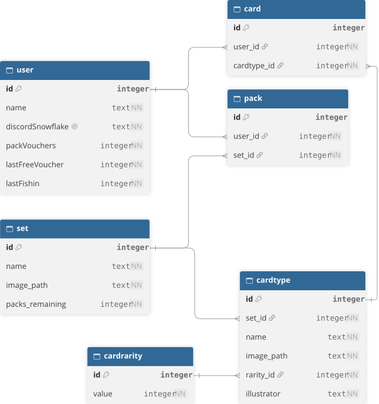

## How are you hosting it?

Currently the project server and database are running on my personal [digitalocean droplet](https://www.digitalocean.com/products/droplets). It is packaged using [docker](https://www.docker.com/). 

For more information about how I host my projects online, check out https://github.com/AndrewLuther/infra.

<!-- This is a work in progress personal project that I began developing recently to expand my experience with databases. I'm using [drizzle ORM](https://orm.drizzle.team/) and [discord.js](https://discord.js.org/) to create a discord bot that allows users to collect and trade virtual cards with each other. The database is a SQLite database, and the project will be hosted on my [digitalocean droplet](https://www.digitalocean.com/products/droplets) once a usable version is complete.

The digital cards will use custom art which I plan to draw myself using a free open-source drawing program called [Krita](https://krita.org/en/).

## Main Dependencies

[discord.js](https://discord.js.org/) -> To interface with discord API
[drizzle ORM](https://orm.drizzle.team/) -> For easy/streamlined SQLite database management
[satori](https://github.com/choowx/satori-php) -> For converting card HTML/CSS to SVG images
[hono](https://github.com/honojs/hono) -> Simple webserver

## DB Schema

A rough idea of my plan for the database. Diagram created using [dbdiagram](https://dbdiagram.io/home).

 -->
